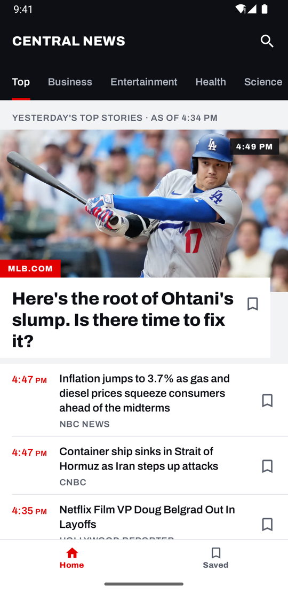
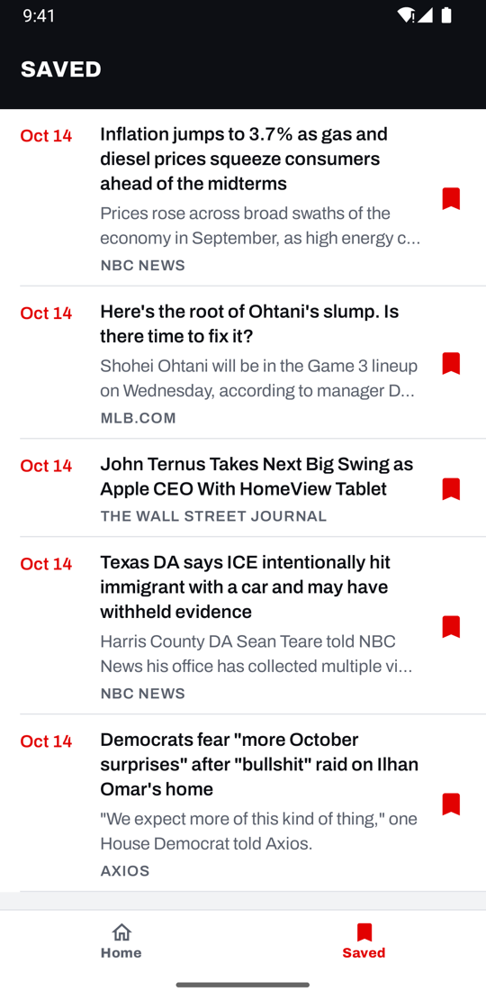
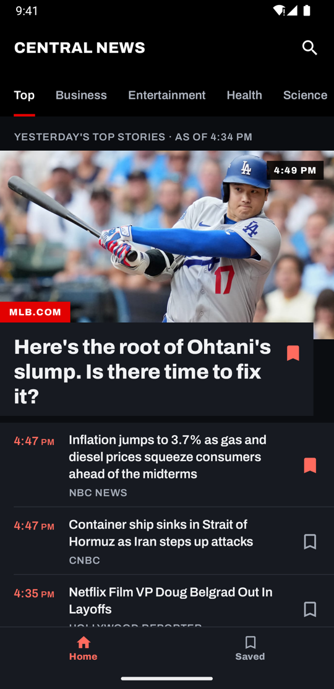

# Central News

An Android app for a quick daily catch-up on the news. It opens on the day's top headlines and leads with the biggest story, then shows a timed list of the rest. Readers can browse by category, search, and save stories to read later.

Built with Kotlin and Jetpack Compose on top of [NewsAPI](https://newsapi.org).

## Screenshots

| Home | Search | Saved | Dark theme |
|:---:|:---:|:---:|:---:|
|  |  |  |  |

## Features

- **Home feed**: top headlines with a lead story, then a timed list of the rest. Pages load as you scroll, and pull to refresh reloads the feed.
- **Categories**: Top, Business, Entertainment, Health, Science, Sports and Technology, as tabs pinned under the top bar. Each category starts from its own top.
- **Search**: results update as you type (400 ms debounce, at least 2 characters). Results can be sorted by **Relevance** or **Latest**, and the last 5 searches are remembered. From search you can also jump back to a category on Home.
- **Saved stories**: bookmark any article from the feed or from search, with an Undo snackbar. Saved stories live in a local Room database, so the Saved tab works offline.
- **Reading**: articles open on the publisher's site in a Chrome Custom Tab.
- **Errors**: specific messages for no connection, timeouts, rate limits and server errors, each with a retry. A failed refresh keeps the current list and reports the problem in a snackbar.
- **Light and dark themes**, following the system setting.
- **Splash screen**: stays up until the first page of headlines has loaded, for at most 2 seconds.

## Requirements

| Tool | Version |
|---|---|
| Android Studio | Hedgehog (2023.1) or newer |
| JDK | 17 |
| Android Gradle Plugin | 8.2.1 (Gradle 8.2 wrapper included) |
| Kotlin | 1.9.24 |
| Android SDK | compileSdk / targetSdk 34, minSdk 24 |

You also need a free NewsAPI key from [newsapi.org/register](https://newsapi.org/register).

## Getting started

1. Clone the repository:

   ```bash
   git clone https://github.com/isahohieku/news-app.git
   cd news-app
   ```

2. Add your NewsAPI key to `local.properties` in the project root. Android Studio creates this file and it is git-ignored:

   ```properties
   NEWS_API_KEY=your_api_key_here
   ```

   The build also reads a `NEWS_API_KEY` environment variable, which is handy for CI. Without a key the app builds, but every request fails with an "unavailable" error (HTTP 401).

3. Build and install on a connected device or emulator:

   ```bash
   ./gradlew :app:installDebug
   ```

   Or open the project in Android Studio and run the `app` configuration.

The key is compiled into `BuildConfig.API_KEY` and sent as the `X-Api-Key` header. Debug builds log requests but redact that header.

## NewsAPI free-plan limits

The free developer plan shapes several behaviours in the app:

- **Country:** top headlines only reliably return results for the US. The app tries the device's country first and falls back to `us` if that comes back empty. Whichever country works is reused for later pages.
- **Result cap:** each query returns at most 100 results. Past that, NewsAPI answers HTTP 426, which the app treats as the end of the list.
- **Request quota:** about 100 requests per day. Hitting it shows a rate-limit message.
- **Search language:** search uses the `/everything` endpoint, filtered to the device language when NewsAPI supports it.
- **Images:** many articles have no image, and the feed is designed to work without one.

## Architecture

The app follows **MVVM** in clean-architecture layers. Dependencies point inwards: `ui` → `domain` ← `data`, and `domain` has no Android or data-layer imports.

```
ui (Compose screens + ViewModels)
        │  uses use cases and domain models
        ▼
domain (models, repository interfaces, use cases)
        ▲
        │  implements repository interfaces
data (Retrofit, Room, SharedPreferences)
```

- **View**: each screen has a `render…Screen` function that connects the ViewModel to the UI. It passes plain state and callbacks to a stateless `…Screen` composable, so every screen can be previewed without a ViewModel.
- **ViewModel**: one per screen (`HomeViewModel`, `SearchViewModel`, `BookmarksViewModel`). Each exposes a single `StateFlow<…UiState>` and depends only on domain use cases.
- **Use cases**: `GetNewsUseCase` and `SearchNewsUseCase` for news; `ObserveBookmarksUseCase`, `ObserveBookmarkedUrlsUseCase` and `SetBookmarkedUseCase` for bookmarks.
- **Results and errors**: data sources return `ResourceState.Success` or `ResourceState.Error`. Network failures become an `ApiException`, which subclasses the domain's `AppException`. The UI only reads its `ErrorType`.
- **Paging**: `ArticlePager` loads one page at a time and is shared by Home and Search. It handles load-more, retry, refresh, and removing duplicates across pages.
- **Dependency injection**: Hilt. `NetworkModule` provides Retrofit and OkHttp, `DatabaseModule` provides Room, and `DataModule` provides the repositories and SharedPreferences.
- **Navigation**: Navigation Compose, with Home and Saved as bottom-bar tabs that keep their state when you switch, and Search as a pushed screen. Tapping Home while already on Home scrolls back to the lead story.

### Project structure

```
app/src/main/java/com/ohieku/newsapp/
├── core/                 App constants and the locale provider
├── data/
│   ├── features/
│   │   ├── bookmarks/    Room entity, DAO, repository implementation
│   │   ├── news/         Retrofit API, DTOs, mapper, data source, repository
│   │   └── search/       Recent searches (SharedPreferences)
│   ├── local/            Room database
│   └── network/          ApiResponseHandler, ApiException
├── di/                   Hilt modules
├── domain/
│   ├── common/           ResourceState, ErrorType, AppException
│   └── features/         Models, repository interfaces, use cases
├── extensions/           Date formatting, browser and HTTP-error helpers
└── ui/
    ├── home/             Home feed screen + ViewModel
    ├── search/           Search screen + ViewModel
    ├── bookmarks/        Saved screen + ViewModel
    ├── common/           Paging, error messages, bookmark and article helpers, startup readiness
    ├── compose/          Theme (colour, type) and shared components
    └── navigations/      Navigation graph, bottom bar, routes
utilities/                Small Android library module (connectivity check)
buildSrc/                 Dependency and version catalogue (Dependencies.kt, Versions.kt)
```

## Tech stack

| Area | Library |
|---|---|
| UI | Jetpack Compose (BOM 2023.08.00), Material 3 1.2.1, Material Icons Extended |
| Navigation | Navigation Compose, Hilt Navigation Compose |
| Dependency injection | Hilt 2.48 |
| Networking | Retrofit 2.9, OkHttp, Moshi |
| Local storage | Room 2.6.1, SharedPreferences |
| Async | Kotlin Coroutines and Flow 1.7.3 |
| Images | Coil 2.2 |
| Other | AndroidX SplashScreen, AndroidX Browser (Custom Tabs) |

Versions are managed in [`buildSrc/src/main/java/Versions.kt`](buildSrc/src/main/java/Versions.kt).

## Testing

Unit tests live in `app/src/test` and run on the JVM:

```bash
./gradlew :app:testDebugUnitTest
```

They cover:

- the three ViewModels: paging, refresh, errors, bookmarks, search debounce and sort, recent searches, and the splash-readiness signal;
- `NewsRepositoryImplementation`: falling back from the device country, and treating HTTP 426 as the end of results;
- `ApiResponseHandler`: turning HTTP and network failures into an `ErrorType`;
- the DTO mapper, the bookmark repository, and date formatting.

The tests use the fakes in `app/src/test/.../fakes/` instead of a mocking library.

Instrumented tests (`./gradlew :app:connectedDebugAndroidTest`) currently contain only the template example.

## Design

- [PRODUCT.md](PRODUCT.md): audience, purpose, constraints and product principles.
- [DESIGN.md](DESIGN.md): the design system, covering colour tokens, typography (Archivo), components and layout rules.

Brand red is `#E20101`, matching the app icon. The UI targets WCAG AA: 4.5:1 text contrast, 48dp touch targets and full TalkBack support.

## Troubleshooting

| Symptom | Likely cause |
|---|---|
| Every feed shows "unavailable" | `NEWS_API_KEY` is missing or invalid in `local.properties`. Rebuild after adding it. |
| "Too many requests" message | The free plan's daily quota (about 100 requests) has been used up. It resets after 24 hours. |
| Feed is empty for your country | NewsAPI has no headlines for that country on the free plan. The app should fall back to `us` automatically. |
| A list stops loading after about 100 stories | The free plan's 100-result cap per query. |
